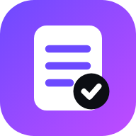

# Recipe Book

**Your recipes, meal plan and shopping list, kept on your computer.**

Import a recipe from anywhere, then plan your week and build the shopping list from it.

  

**[⬇ Download for Windows](https://github.com/Pixcel-Pirate/RecipeBook/releases/latest/download/RecipeImporter-Setup.exe)** · **[Open the web app](https://pixcel-pirate.github.io/RecipeBook/)** · **[All releases](https://github.com/Pixcel-Pirate/RecipeBook/releases)**

[What it does](#what-it-does) · [Install](#install) · [Privacy](#privacy) · [Build from source](#build-from-source) · [License](#license)

---

No account, no subscription. Recipe Book takes recipes from anywhere and turns them into one tidy format: a copied web page, a text from a friend, your own notes, or a file. Each recipe gets a title, source, servings, prep and cook time, ingredients (amount, unit, name), steps, tags and notes. Check it over, save it to your library, and export the lot whenever you want.

## What it does

- **Import:** paste recipe text, or open `.txt`, `.md`, `.html` or `.json` files. It finds the title, the ingredient list, the steps, servings, times, tags and notes. Messy text works too: if there are no headings, lines that start with an amount become ingredients and the rest become steps. Saved web pages (`.html`) are read from the recipe data most recipe sites include.
- **Links:** put the recipe's link in the link box and it's saved as the source. Most sites don't let other apps read them directly, so if a link alone doesn't work, open the page, press Ctrl+A, copy, and paste it in.
- **Check it over:** every import opens in an editor first, one ingredient or step per line, so fixing a line is just typing.
- **Library:** search by title, tag or ingredient, filter by tag or favorites, scale servings up or down, and copy any recipe as Markdown.
- **Planner:** a week calendar with breakfast, lunch, dinner and snack. Plan a recipe from its page or with **Add** on any day, set servings per meal, drag meals to another day, and add notes like "eating out".
- **Shopping list:** pick a date range and every planned recipe's ingredients are scaled, combined (1 cup + 2 tbsp milk becomes 1 1/8 cups) and grouped by aisle. Tick items off as you shop, add your own items, and move an item to another aisle: it remembers next time.
- **Export:** download one recipe or the whole library as JSON, or everything as one Markdown file. The JSON can be imported back here, or into the Recipe Book app.

## Install

**Windows app:** run [RecipeImporter-Setup.exe](https://github.com/Pixcel-Pirate/RecipeBook/releases/latest/download/RecipeImporter-Setup.exe). It installs for your user only and adds a desktop shortcut. The app isn't code-signed, so Windows may show "Windows protected your PC". If it does, click **More info**, then **Run anyway**.

**Web app (works offline):** open https://pixcel-pirate.github.io/RecipeBook/ in Edge or Chrome, then click **Install** in the address bar.

## Privacy

No accounts, no tracking, no ads. Your recipes stay on your own computer. The app only goes online to read a link you give it and to check GitHub for a new version.

## Build from source

    npm install
    npm run dev      # preview in the browser
    npm test         # parser checks
    npm run build    # production build in dist/

The parser lives in `src/lib/recipe.ts`. Releases are built by `.github/workflows/release.yml`: push a tag like `v1.0.0`, or run the workflow by hand.

## License

[MIT](LICENSE) © 2026 Pixcel. If Recipe Book saves you time, you can [buy me a coffee](https://buymeacoffee.com/saucie83g).
